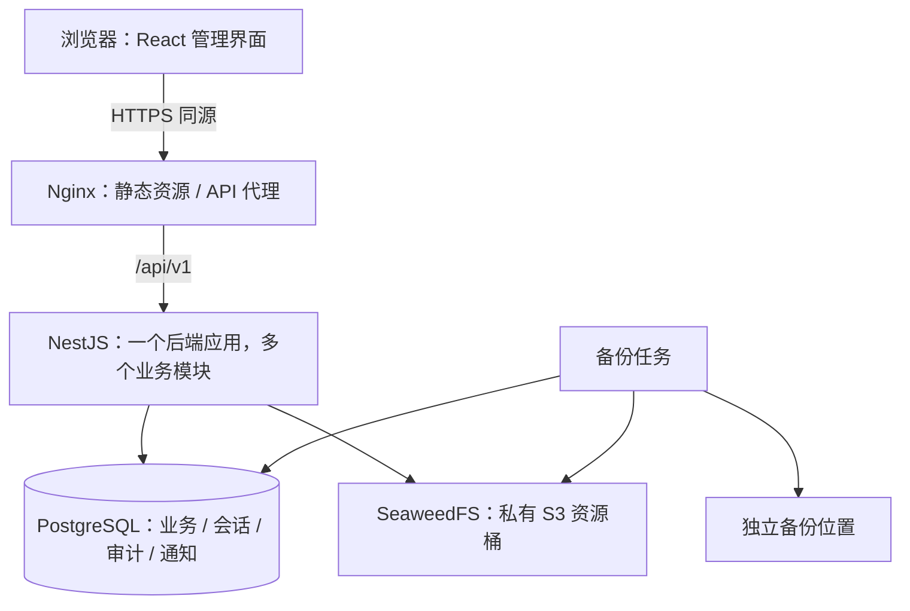

# 技术选型与架构设计

版本：0.8；更新日期：2026-10-28；关联任务：M0—M4。  
状态：工程、账号、项目/迭代、协作、需求/任务、用例及 M4 提测/执行/缺陷已实现；实际验证见各批记录，生产部署及容量仍未验证。  
决策摘要：[ADR-001：后端与部署基线](adr/001-technology-and-architecture.md)、[ADR-002：React 前端](adr/002-react-frontend.md)。前端以 ADR-002 为准；正式执行快照采用 [ADR-006](adr/006-test-case-execution-snapshot.md)。

## 1. 选型结论

采用 TypeScript 为主的前后端分离架构：React 管理界面、NestJS 模块化单体后端、PostgreSQL 关系数据库。通过 pnpm workspace 维护同一仓库，生产环境先按单机 Docker Compose 部署。

默认条件：小团队维护、内部浏览器应用、单组织多项目、无既有 Java/Python 平台约束。实际团队技术偏好和部署资源尚未提供，这些是工作假设，不代表已确认的组织事实。后续出现明确约束时通过新 ADR 调整。

| 层次       | 采用方案                                             | 在本项目中的职责                                                       |
| ---------- | ---------------------------------------------------- | ---------------------------------------------------------------------- |
| 前端       | React 19、TypeScript、Vite                           | 需求、看板、用例、缺陷等业务页面                                       |
| UI         | Ant Design 6、CSS Modules、统一主题 token            | 表单、表格、弹窗、上传、状态和操作反馈                                 |
| 路由       | React Router，Declarative 模式                       | 项目空间、嵌套路由、登录及访问提示                                     |
| 状态管理   | React 本地状态、Zustand、TanStack React Query        | 本地状态管理页面交互；Zustand 仅管理共享界面偏好；Query 管理服务端数据 |
| HTTP       | 原生 fetch 封装                                      | 统一凭据、CSRF、错误、超时/取消、请求编号                              |
| 后端       | NestJS 12、Express 适配器、TypeScript                | 业务模块、授权、命令、事务及查询                                       |
| 契约校验   | Zod、共享 contracts 包                               | 请求/响应结构、枚举、运行时校验；配合 OpenAPI                          |
| ORM 与迁移 | Prisma ORM 7、PostgreSQL 驱动适配器                  | 类型化数据访问、事务、迁移；特殊约束用受控 SQL                         |
| 数据库     | PostgreSQL 17（当前 17.11）                          | 核心业务、会话、审计、通知与幂等记录                                   |
| 文件       | SeaweedFS 私有 S3 桶                                 | 附件与图片；服务端授权代理读写，详见 ADR-004                           |
| 认证       | 服务端会话 + HttpOnly Cookie                         | 登录、退出、账号停用及会话撤销                                         |
| 权限       | 项目 RBAC + 对象/状态策略                            | 角色权限、项目隔离、归档和操作前置条件                                 |
| 测试       | Vitest、React Testing Library、Supertest、Playwright | 规则单测、组件关键交互、真实数据库接口测试、闭环端到端验证             |
| 质量       | TypeScript strict、ESLint、Prettier                  | 类型、规则和格式检查                                                   |
| 工作区     | pnpm workspace                                       | apps 与共享契约的依赖、脚本及锁文件                                    |
| 运行环境   | Node.js 24 LTS、ESM                                  | 本地、检查环境和生产保持同一主版本                                     |
| 部署       | Linux、Docker Compose、Nginx                         | TLS 入口、静态资源、API 代理及容器管理                                 |
| 可观测性   | 结构化应用日志、request_id、健康检查                 | 排错、请求关联及基本运行状态                                           |

这些是技术选择，不能替代授权、领域规则和数据库约束。首期额外基础设施仅在明确需要后加入。

## 2. 版本与兼容性策略

| 组件              | 版本策略                                | 实施要求                                                                          |
| ----------------- | --------------------------------------- | --------------------------------------------------------------------------------- |
| Node.js           | 24.x LTS，至少满足选定 CLI 的要求       | Nest 12 CLI 当前文档对 24.x 要求为 24.15+；初始化时固定该分支最新合适补丁         |
| NestJS            | 12.x                                    | 核心、CLI、平台适配器及配套包必须按实际 peerDependencies 匹配，不能假定所有包同号 |
| TypeScript        | 6.x 作为目标                            | Nest 12 schematics 当前要求 TS 6；验证 React 类型定义、测试和 ORM 组合            |
| React / UI / Vite | React 19.x、Ant Design 6.x、Vite 稳定版 | react/react-dom 版本匹配，类型与图标包匹配；初始化时固定正式补丁版本              |
| Prisma            | 7.x                                     | 对照 v7 文档，使用 ESM 和 PostgreSQL 驱动适配器；不混用 v8 API                    |
| PostgreSQL        | 17.x（当前 17.11；18 为早期基线）       | 固定支持中的补丁版本；升级前验证迁移和备份恢复                                    |
| pnpm              | 稳定版，目标 12.x                       | 在 packageManager 固定完整版本；锁文件入库，检查环境冻结安装                      |

依据核验：Node 官方列出 24 为 LTS、20 为 EOL；Nest 官方迁移指南说明 v12 的 ESM、CLI Node 版本和 TS 6 要求；Prisma 的 v7 与 v8 文档目前并存，应明确使用 v7；PostgreSQL 支持列表包含 18。[Node 版本](https://nodejs.org/en/about/previous-releases)、[Nest 12 迁移](https://docs.nestjs.com/migration-guide)、[Prisma v7](https://www.prisma.io/docs/orm/v7)、[PostgreSQL 支持策略](https://www.postgresql.org/support/versioning/)、[pnpm 安装与兼容性](https://pnpm.io/installation)。

本机全局工具仍为 Node v20.20.2、pnpm 9.10.0；本项目使用 .tools 中的 Node 24.22.1、pnpm 12.15.0。早期验证使用 PostgreSQL 18.4；2026-10-28 按用户要求切换到 localhost:5432 的 PostgreSQL 17.11 和已有 Docker SeaweedFS，旧业务库及附件已迁移。WSL 原生 Docker CLI 未集成，当前通过 Docker Desktop 的 docker.exe 管理容器；详见 ADR-003/004。全局工具未修改。

M0-02 已完成小范围兼容性验证：前端类型检查/构建、API 启动、Prisma 生成/迁移/事务、测试运行及附件存储适配器。HTTP 附件上传/下载已于 M1-04 接入。Nest 装饰器元数据和 ESM 的测试编译要单独验证，不能仅凭依赖安装成功判定兼容。若正式版本组合不兼容，先记录问题并评估调整，不使用预发布版本强行拼接。

## 3. 为什么采用该方案

| 决策                | 本项目理由                                                                     | 替代方案及重新评估条件                                                |
| ------------------- | ------------------------------------------------------------------------------ | --------------------------------------------------------------------- |
| React + Ant Design  | 围绕复杂列表、表单、看板及测试工作台建立可组合组件，结合本次 React 选型倾向    | Vue 同样能满足需求；若实际维护团队有强约束，再用 ADR 评估调整         |
| NestJS              | 模块、依赖注入、控制器和守卫便于组织复杂流程与权限；前后端共享 TypeScript 契约 | 如果实际团队以 Java/Spring 或 Python 为主，评估替换后端以减少维护成本 |
| PostgreSQL          | 对象关系多，需要事务、约束、历史查询及快照数据                                 | 已有强制数据库标准时再评估迁移成本与语义差异                          |
| Prisma 7            | 统一类型化访问与迁移，便于落地多关系数据模型                                   | ORM 表达不足的约束用 SQL 迁移；不为迁就 ORM 削弱完整性                |
| 模块化单体          | 需求、测试、缺陷和发布规则紧密，单数据库事务易于保证一致性                     | 出现独立团队、独立发布或明显独立负载后再拆服务                        |
| 独立 SPA + REST API | 内部应用以登录后操作为主，页面与接口边界清楚                                   | 若出现公开内容和搜索收录需求，再评估独立 SSR 入口                     |
| 单机 Compose        | 服务数量少，可清楚描述配置、网络、持久卷及恢复方式                             | 明确要求多机容错时改为托管数据库、对象存储及多实例部署                |

上述为基于当前需求的工程判断，不表示 React 在所有场景优于 Vue。React 官方提供 Vite + TypeScript 的 SPA 建立方式，也提醒需要自行选定路由、数据加载等配套方案；本项目用 React Router 和 TanStack Query 明确这些边界。Ant Design 6 官方说明支持 React 18 及以上版本，并已纳入 React 19 支持。[React SPA 建立方式](https://react.dev/learn/build-a-react-app-from-scratch)、[Ant Design 6 兼容性](https://ant.design/docs/react/migration-v6/)、[React Router 模式](https://reactrouter.com/start/modes)。

## 4. 总体部署结构



- Nginx 对外提供一个站点，`/` 为静态页面，`/api/v1` 转发后端；SPA 路由回退不影响 API 错误响应。
- API 与数据库使用内部网络，数据库不公开到互联网；运行配置通过环境或受限配置文件注入。
- 首期后端单实例，数据库与 SeaweedFS 数据使用持久卷；重建容器不删除业务数据。
- 应用容器不承载源码热更新和开发工具；数据库迁移作为单独部署步骤执行。
- TLS 证书和域名按实际部署环境接入，本次未申请或配置外部资源。
- 该拓扑存在单机故障点；备份解决恢复，不等价于高可用。

Docker 官方提供 Compose 的生产配置组合方式；本项目的环境隔离、备份和恢复要求仍需在 M6 验证。[Compose 生产部署](https://docs.docker.com/compose/how-tos/production/)。

## 5. 后端模块与依赖

| 模块          | 拥有的数据与职责                                     |
| ------------- | ---------------------------------------------------- |
| identity      | 用户、凭据、会话、账号启停                           |
| projects      | 项目、成员角色、归档与恢复                           |
| iterations    | 迭代计划、状态与关闭门禁，需求/任务共用计划基础      |
| requirements  | 需求、修订、评审、范围变更                           |
| tasks         | 开发任务、分配、阻塞及状态                           |
| test-cases    | 用例、修订、评审及需求关联                           |
| testing       | 提测、测试批次、快照及执行结果                       |
| defects       | 缺陷、修复、复测、特殊处理结论                       |
| delivery      | 版本、构建、验收、发布检查、风险批准、发布及上线验证 |
| collaboration | 评论、附件元信息、审计、通知                         |
| reporting     | 工作台、交付摘要、复盘及只读聚合                     |

模块内部采用 Controller → Application Service → 领域规则/策略 → Repository 的依赖方向；基础设施实现数据库和文件适配器。普通查询允许直接通过模块 Repository 聚合，避免为简单表单建立过多抽象层。

- Controller 处理协议和输入，不实现状态流转。
- Application Service 编排用例、权限、事务和结果。
- 领域规则表达 BR-01—BR-20，保持便于独立验证。
- 模块通过显式服务/查询接口协作，不随意写入他人表。
- 需要跨模块一致性的命令由应用服务编排，共享同一事务上下文；禁止各模块自行提交造成部分成功。
- 同步关键规则直接调用；首期站内通知和审计随业务事务写入。外部通知以后采用事务发件箱，不能在数据库事务中等待网络回调。
- 不把所有流程塞进通用状态表或万能 CRUD，状态命令保留业务语义。

## 6. 仓库与工程目录

以下为工程结构及扩展方向；web、api、contracts、脚本、迁移和测试已创建，尚未实现的领域模块按计划逐步增加。

```text
myteam/
├── apps/
│   ├── web/src/
│   │   ├── app/             # 路由、插件、全局初始化
│   │   ├── modules/         # 按需求/任务/测试等业务组织
│   │   ├── components/      # 跨模块通用组件
│   │   ├── api/             # fetch 客户端、查询封装
│   │   └── styles/          # 主题变量和通用布局
│   └── api/
│       ├── src/modules/     # 业务模块及其分层
│       ├── src/common/      # 认证、授权、事务、错误、日志
│       ├── src/infrastructure/
│       └── prisma/          # schema、迁移、演示种子数据
├── packages/
│   └── contracts/           # DTO schema、枚举及响应结构
├── tests/e2e/               # Playwright 跨角色闭环
├── infra/                   # Compose、Nginx、备份说明
├── docs/
├── package.json
├── pnpm-workspace.yaml
└── pnpm-lock.yaml
```

正式执行快照采用独立版本化共享契约，历史草稿格式保持兼容；服务在调用方授权事务内生成完整只读副本，M4 在该事务内复制到执行项并提供数据库不可覆盖约束，见 ADR-006。

contracts 不能依赖数据库客户端、Nest 容器或前端框架，不对浏览器暴露实体、密码字段和内部模型。其类型由 schema 推导；数据库实体与 API DTO 分别维护，避免无意泄露字段。前后端配置独立，只有构建所需的公开配置可进入前端产物。

## 7. 前端实现约定

- 按业务模块组织页面、查询和表单；统一列表筛选、详情页、状态展示及操作确认。
- 服务端数据（含当前登录用户）由 Query 管理；当前项目以路由为准，Zustand 仅保存跨页面的共享界面偏好，避免重复存储整套业务数据。
- React Router 采用 Declarative 模式，服务端加载由 Query 负责，避免同时维护 router loader 和 Query 两套缓存。后续确需路由预取时另行评估。
- 首期表单使用 Ant Design Form，输入/响应结构使用共享 Zod schema；适配重复校验规则，不再叠加另一套表单框架。
- 使用 React 函数组件和 hooks，界面副作用可清理；Query key 必须包含项目、筛选及分页，切换身份时清理敏感缓存。
- 页面收到 API 返回的 `allowedActions` 可用于按钮展示，但 API 对每次操作重新授权。
- 状态变更优先等待服务端确认；涉及发布、验收等动作不做乐观成功展示。
- 请求失败保留输入；并发冲突提示重新加载和比对，不自动覆盖他人的修改。
- 列表筛选写入路由查询参数，刷新和分享项目内链接可恢复视图。
- 用例步骤采用结构化编辑；首期描述使用纯文本/受控 Markdown，展示时不执行原始 HTML。
- 目标浏览器为当前主流桌面浏览器最近两个稳定版本，关键界面适配窄屏；原生移动端后置。

## 8. 数据、事务和并发

### 8.1 数据建模

- 核心对象使用内部 UUID；可读编号通过项目计数器或数据库原子分配生成，不使用 `count + 1`。
- 关系、负责人、状态等可检索信息使用关系字段；用例/验收/检查快照用 JSONB 保存当时内容。
- 使用 timestamptz 保存时间点，API 使用带时区 ISO 8601；界面按用户时区展示，默认 Asia/Shanghai。计划日期独立为 date。
- 金额暂不涉及；工时按整数分钟或明确精度的数值保存，不能用浮点随意累计。
- 项目相关表带 project_id，尽可能使用组合外键约束同项目关联；服务端校验与数据库约束配合。
- 唯一约束覆盖业务编号、成员角色、构建标识、幂等键及必要的关联重复。
- 大表按实际查询建立 project_id + 状态/负责人/时间等索引，分页设置上限，禁止无界加载。
- 迁移由 Prisma Migrate 管理；数据库特有约束和索引通过审查后的 SQL 迁移实现，不启用预览特性作为 P0 关键保证。

### 8.2 状态命令

统一命令顺序：认证 → 输入校验 → 项目与操作授权 → 事务内复查可变条件 → 状态/版本检查 → 领域规则 → 数据更新及证据 → 审计/站内通知 → 提交。

- 一般编辑采用 version 乐观锁，更新条件包含对象 ID 和旧版本；未更新到记录返回冲突。
- 发布检查、需求变更、缺陷新增/重开等会影响交付资格的写操作，使用一致的锁顺序协调版本/范围行；资格检查与写入处于同一事务。
- 跨记录门禁使用行锁或 Serializable 事务配合有限冲突重试；不能只锁发布记录却允许阻断缺陷并发绕过。
- 单任务活动提测通过独立活动关联表及 task_id 唯一约束或等效数据库约束保障，不能仅在前端判断。
- 幂等键绑定操作者、动作、目标及请求摘要；同键同参数返回原结果，不同参数拒绝。
- 数据库事务不包含文件传输、部署执行或第三方 HTTP 调用。

Prisma v7 提供事务及隔离级别配置，具体 API 以版本化文档为准。[Prisma v7 事务](https://www.prisma.io/docs/orm/v7/prisma-client/queries/transactions)、[PostgreSQL 适配器](https://www.prisma.io/docs/orm/v7/core-concepts/supported-databases/postgresql)。

## 9. 认证、权限与附件

### 9.1 会话

- 首期本地账号，密码使用 Argon2id 哈希；管理员通过受控初始化命令创建，不提供默认弱口令。
- 登录生成高熵随机会话令牌；浏览器仅通过 HttpOnly Cookie 携带，数据库保存令牌摘要。
- 生产 Cookie 使用 Secure、SameSite=Lax、限制 Path；绝对有效期默认 8 小时。
- 登录轮换会话；退出、账号停用及敏感凭据变更撤销对应会话。
- 写请求校验 CSRF token 和 Origin，登录同样校验来源；开发环境采用 Vite API 代理维持同源交互。
- 项目成员资格每次请求重新验证，角色调整即时生效；前端缓存不作为授权依据。
- 登录错误不区分账号不存在与密码错误，入口设置失败限速。审计不记录密码、Cookie 或 CSRF token。

### 9.2 权限

RBAC 确定允许操作的角色，策略进一步判断项目归属、负责人、业务状态、归档及前置条件。角色可兼任的规则沿用需求基线。系统管理员越权访问或处理业务必须留痕。

### 9.3 附件

- 首期单文件上限 20 MiB，可接受类型先限定 PNG/JPEG/WebP、PDF、TXT/Markdown；SVG、HTML 和可执行内容不直接接受。
- 校验文件大小、扩展名和可识别内容类型；服务端随机存储键，不信任上传路径和文件名。
- 文件保存到 SeaweedFS 私有桶，通过带业务授权的 API 流式下载；默认作为附件返回，避免任意内容在主站执行。
- 上传对象在数据库事务外完成，再以短事务复查权限并写元信息/审计/通知；明确回滚时补偿删除，提交结果不明时保留对象，定期按保护窗口清理。
- API 通过 S3Storage 访问 SeaweedFS，保留稳定业务 ID、桶和完整对象键；运行时没有本地存储回退，详见 [ADR-004](adr/004-seaweedfs-resource-storage.md)。
- 数据库与文件共同备份，恢复时校验引用完整性。

## 10. API 与契约方向

- REST/JSON，前缀 `/api/v1`；查询接口与状态命令区分，例如 `POST /requirements/:id/submit-review`、`POST /defects/:id/submit-fix`。
- 输入及响应 schema 由 contracts 定义，Nest 侧执行运行时校验；OpenAPI 从同一套契约导出，不能手写两份失去同步。
- 普通编辑携带 version；敏感或可重试命令携带 Idempotency-Key；统一错误包括 code、message、details、requestId。
- 分页默认 20、最大 100；稳定排序包含唯一 ID；时间线等大数据查询后续按需使用游标。
- HTTP 状态区分未认证、无权限、不存在、校验失败、并发冲突及业务条件不满足，具体结构已在 [接口约定](api-conventions.md) 固定。
- 内部业务枚举存储稳定代码，中文标签由展示层映射，不以中文文案作为协议值。

Nest 12 官方校验文档支持 Standard Schema；本项目采用共享 Zod schema 执行校验，并从相同 schema 导出 OpenAPI，已通过首批接口检查；后续新增接口仍需对应验证。[Nest 校验](https://docs.nestjs.com/application/validation)。

## 11. 首期容量与运行目标

以下为设计和验收目标，依据当前小团队场景制定，尚未压测，不是已经具备的能力承诺。实际资源或业务规模变化时修订本节和 M6 验收数据。

| 项目          | 首期基线                                                                  |
| ------------- | ------------------------------------------------------------------------- |
| 组织与账号    | 单组织，最多 100 个活跃账号作为初始验证规模                               |
| 并发          | 30 个并发虚拟用户，包含列表/详情和少量状态命令，具体比例在压测脚本记录    |
| 数据          | 50 个项目、合计 10 万条需求/任务/用例/缺陷、100 万条执行结果/历史日志量级 |
| 普通列表/详情 | 目标 p95 ≤ 500 ms（API 服务端耗时，分页，不含文件传输及外部网络）         |
| 普通状态命令  | 目标 p95 ≤ 1 s（同上），独立检查失败率及一致性                            |
| 参考运行资源  | Linux 4 vCPU / 8 GiB 内存 / 100 GiB SSD；容量含系统与初期附件，需监控增长 |
| 查询刷新      | 站内待办与通知默认 30 秒轮询，可在页面不可见时暂停                        |
| 备份目标      | 每日数据库与附件备份，保留 7 日及 4 周归档，至少一份在独立位置            |
| 恢复目标      | 初始 RPO ≤ 24 小时、RTO ≤ 4 小时，M6 在参考数据规模演练                   |

日志轮转、附件配额及备份存储空间在部署配置中限制。实际服务器、域名、备份位置和责任人待部署时补充；当前没有购买、创建或连接外部服务。

## 12. 工程验证与发布

- 单元层：状态规则、权限策略、门禁、编号、幂等及快照不变性。
- 接口层：Supertest 调用真实 Nest 应用，使用独立 PostgreSQL 测试库验证事务、唯一约束、锁及并发，不用 SQLite 代替数据库语义。
- 页面层：React Testing Library/Vitest 覆盖关键复杂交互；Playwright 验证跨角色完整闭环。
- 检查流水线：冻结依赖安装 → 静态/类型检查 → 单元/数据库集成 → 前后端构建 → 关键端到端 → 产物。具体 CI 托管平台待源码仓库确定，不绑定外部服务。
- 发布应用时保留构建标识、迁移记录和配置版本；自动运行检查不等于自动获准部署生产。
- 迁移优先向前兼容，应用回退与数据库恢复分开；不能假定每次迁移可直接反向执行。
- 数据备份与应用回退必须通过 M6 演练，未演练前保持“待验证”。

## 13. 演进边界

| 需求触发                       | 演进方向                                                   |
| ------------------------------ | ---------------------------------------------------------- |
| 多实例或附件容量明显增加       | 数据库独立部署，SeaweedFS 扩容与多副本，会话仍可共享数据库 |
| 第三方通知、导入等后台工作增多 | 引入事务发件箱与持久任务处理；需要时再选队列和 Redis       |
| 搜索规模及查询复杂度明显增加   | 先验证 PostgreSQL 索引/全文能力，再评估专用搜索服务        |
| 团队确需实时协作               | 加入 SSE/WebSocket，继续由服务端校验权限和并发版本         |
| 单模块有独立团队和扩缩需求     | 从现有模块边界拆服务，先明确数据所有权及一致性协议         |
| 组织要求集中身份与审计         | 接入单点登录，增强审批和职责分离                           |

首期保留清楚的模块和适配接口，不预先部署 Kubernetes、消息集群、搜索集群或通用工作流引擎。

## 14. 下一步实施清单

M0-01 已完成（技术方案层面），当前前端以 ADR-002 的 React 方案为准，后续运行及容量验证仍独立执行。

M0-02/03/04 已执行，细节见 [运行决策](adr/003-local-development-runtime.md)、[公共契约](api-conventions.md) 和 [验证记录](verification/m0-identity.md)。以下保留初始化检查项；M1 已完成验证，M2—M4 已完成实现，当前验证记录以各批记录及本文末尾 M4 接入为准：

1. 采用项目级方式准备 Node 24 LTS 和固定 pnpm，避免未经需要改动全局工具。
2. 确认本机 PostgreSQL 来源或 Docker daemon/Compose 可用，记录实际环境。
3. 创建 workspace、web、api、contracts，固定正式版本与锁文件。
4. 验证 React 类型检查/构建、Ant Design 核心交互、Nest ESM/装饰器元数据及测试编译、Prisma 生成/迁移/事务。
5. 建立数据库和附件持久卷、示例配置、健康检查；生产拓扑先写配置，不执行实际生产部署。
6. 更新 README 的真实启动命令，记录检查结果，继续 M0-03/04。

## 15. 项目模块实施补充

InfrastructureModule 提供数据库、命令和配置，IdentityModule 提供账号会话，ProjectsModule 提供项目/成员；跨模块通过显式服务接口协作。项目读写每次检查成员与角色，敏感命令在事务中锁定并复查，幂等重放前也执行当前授权。项目编辑器和状态对话框使用打开时的版本快照，避免后台刷新替换版本后覆盖他人修改。

项目/成员、账号创建和管理员越权留痕已实现。界面细节见 [UI 基线](ui-design.md)，本批证据见 [验证记录](verification/m1-projects.md)。后续迭代、需求等模块继续使用这些权限与契约，不直接写入他人模块数据。

添加成员通过项目级候选账号接口进行远程搜索与分页，只有成员管理者可读取未加入项目的可用账号；普通项目读取权限不等于系统账号检索权限。候选结果仅返回姓名、邮箱和标识，最终写入仍在事务中检查实时权限与账号状态。

## 16. 基础迭代实施与 M2 接入约定

IterationsModule 导入 IdentityModule 与 ProjectsModule，复用项目授权，导出 IterationsService。迭代日期须在已设置的项目日期范围内；反向修改项目日期也不能排除已有迭代。未关闭迭代负责人须留在项目且账号可用；已关闭迭代保留负责人和计划历史。

WorkItem 作为需求/任务的共同计划基础，统一稳定 ID、projectId、iterationId、kind、title 与 resolution。后续领域模型以相同 ID 扩展具体状态、评审与分配，不复制迭代归属，不把所有业务状态放进通用状态机。OPEN/DONE/CANCELED 表达关闭门禁所需的处理结论，须与具体业务状态在同一事务维护。当前只在迭代详情读取基础范围，无公开修改此基础对象的入口。

M2 约定：领域终态 COMPLETED 映射到 DONE，CANCELLED 映射到 CANCELED，草稿/开发/提测/测试/验收中的其他状态均为 OPEN；不能把“开发完成”或“测试通过”提前作为关闭依据。重新打开已完成事项也须检查迭代可纳入性，已关闭迭代须先按后续结转规则处理，不能直接恢复 OPEN。

M2 在领域授权后调用 `IterationsService.assertAssignable(tx, projectId, iterationId)`，获得项目锁并校验目标迭代可纳入事项；创建/改派计划归属、更新结论、关闭迭代均复用同一项目锁。复合外键保证同项目关联；关闭命令检查整个迭代的 OPEN 数量，不能只检查当前页。未来结转还需 M5-06 的历史记录、原因、责任人与去向，不允许直接清空归属来规避关闭门禁。

实现与真实证据见 [迭代验证](verification/m1-iterations.md)。

## 17. 通用协作接入约定（M1-04）

`collaboration` 模块已实现 Comment、Attachment、Notification，复用项目授权及锁、Commands 幂等和 SeaweedFS S3 私有存储。对象类型当前开放 PROJECT/ITERATION/REQUIREMENT/TASK/TEST_CASE；目标的项目归属、存在性、可写状态由服务端检查。后续其他模块接入时，须同步扩展目标 schema 与服务端对象授权，不能允许客户端传入任意类型直接存储。

事务内事件服务 `CollaborationEvents` 由基础设施模块导出，接收调用者的 TransactionClient，同时保存审计及需要的站内通知，不自行启动事务、不执行外部网络调用。基础迭代已接入分配、修改和状态消息；其他现有项目审计继续保持原有事务，不为历史数据补发消息。评论和附件事件只记录对象及必要元信息，不复制评论正文或文件内容到日志。

附件上传采用同源 Cookie + CSRF 的原始二进制 API，最多 20 MiB。先授权及校验格式，再在数据库事务外写 SeaweedFS；短事务重新检查权限和状态，提交附件引用、审计、通知与幂等结果。下载重新授权后在事务外从 S3 流式读取。补偿失败或提交结果不明的对象按 24 小时保护窗口和最新数据库引用清理，避免误删已提交资源。

资源存储唯一实现为 S3Storage，配置、旧附件迁移、提交结果不明处理及备份边界以 [ADR-004](adr/004-seaweedfs-resource-storage.md) 为准。

通知仅查询本人、当前仍有权限的项目数据，项目成员移除后历史消息与未读数一并隐藏。通知已读可以重复调用，不改变首次已读时间。当前负责人评论/附件及迭代分配与状态通知已接入；尚未实现的领域模块不能由这些历史通知推断业务待办已完成。

## 18. 应用框架与待办接入约定（M1-05）

workbench 模块提供只读聚合接口 `/workbench/todos`，当前来源为本人负责且有项目访问权的 PLANNING/ACTIVE 迭代。采用已有 ownerId/status 索引及成员关联过滤，在一个 RepeatableRead 快照内取得分页列表、总数及状态统计，不创建重复的待办状态表。隐藏待验收/完成/归档项目，逾期按上海时区与计划截止日计算。

后续需求、任务、评审、测试等模块接入时扩展公开事项类型及领域查询：每种来源均须约束当前负责人/处理人、项目权限和允许状态，统一列表与统计口径。通知保留历史，不能作为当前未完成工作的来源；当前迭代跟进尚未包含需求评审和任务来源，需求评审自身的实现见下一节。

前端新增统一项目切换入口，通过已授权项目查询搜索和分页；当前项目继续由路由确定。按项目 ID 重挂详情组件，切换时清除上一项目的编辑、弹窗和对象筛选状态。项目列表的返回上下文仅解析为站内项目列表查询，不接受任意跳转地址。查询键包含用户及项目，统一处理会话失效并移除旧数据。

M1-05 验证记录见 [应用框架验证](verification/m1-framework.md)。资源仍使用 SeaweedFS，任务未新增数据库结构或向业务库写入演示内容。

## 19. 需求评审实施（M2-01）

`Requirement` 以与 WorkItem 相同的 UUID 扩展需求内容、负责人、状态、修订及评审轮次；通过 `[projectId,id]` 复合外键保证同项目，不复制标题与当前迭代。数据库约束要求其 WorkItem.kind 为 REQUIREMENT，并禁止之后改成任务。项目维护事务内递增的 requirementSequence，失败不消耗编号。

`RequirementsService` 的写命令沿用 Commands 与项目行锁；负责人和评审人必须为本项目可用成员，候选用户行用共享锁协调账号停用。移出成员、停用账号或收回评审角色时检查未结束需求与待评审责任；撤回后可重排评审，草稿可移交负责人。评审记录与审计、通知、幂等记录和领域状态同事务提交。所有跨项目读取、写入、评论和资源下载都重新验证权限。

RequirementReview 保存每次提交及结论的完整 JSON 快照、round/revision、指定评审人、实际操作者、意见和时间；数据库触发器禁止更新评审记录。每轮结论引用提交时的内容，确认再次比较内容及关联对象 ID；成员/迭代改名不应破坏有效基线。退回/撤回允许从待评审状态恢复至草稿，保留原始快照。

当前实现草稿 → 待评审 → 已确认，以及退回/撤回至草稿、取消草稿。已确认只读；后续修订影响、任务驱动的实现状态、验收完成分别按 M2-04、M2-02/03、M5-01 接入，不能直接开放完整状态枚举的任意写入。确认后 WorkItem 仍 OPEN，迭代关闭检查继续覆盖真实需求。

## 20. 任务拆解与分配实施（M2-02）

Task 以同 ID 扩展 WorkItem，采用 `[projectId,id]` 复合外键；与 Requirement 的 `[projectId,requirementId]` 外键保证同项目。标题、当前迭代与处理结论只保存在 WorkItem；Task 保存固定的需求关联、项目内编号、说明、优先级、负责人、Decimal 估算、日期、领域状态及并发版本。数据库触发器保证 WorkItem.kind 为 TASK 且不能之后改变，估算与编号有 CHECK 约束。

`TasksService` 复用项目锁、Commands、身份与项目策略、IterationsService.assertAssignable。创建/改派时验证可用成员及任务权限，锁定候选用户协调账号停用；项目锁串行协调角色收回、成员移出、迭代关闭和需求状态。开发维护本人任务或本人创建的未分配计划，认领与改派分开授权；负责人代理开始需原因，权限/责任检查也在幂等重放前执行。

任务历史读取同事务写入的 ActivityLog，以任务 ID 和 `task.` 动作筛选、分页，保存编辑和改派前后快照。CollaborationEvents 新增可选额外接收人，在一条业务审计下向去重的项目可用成员通知，排除操作者；沿用统一事务边界，不从通知推导当前负责人或任务状态。

开始时同时更新 Task TODO → IN_PROGRESS、首次 Requirement CONFIRMED → IMPLEMENTING、审计/通知及幂等。确认基线和需求内容 revision 不变。两类 WorkItem 仍 OPEN，继续阻止迭代提前关闭。需求取消前检查未结束任务，避免关联任务被锁在已取消父需求下。任务取消/阻塞将在 M2-03 扩展，不能用通用 PATCH 状态代替领域命令。

## 21. M2 完成：开发状态、修订影响及当前工作台

Task 增加独立阻塞字段及协助人、开始/核对时的 basisRevision。阻塞、恢复、取消、核对使用任务领域命令，沿用当前责任权限、项目锁、version 与幂等；取消同步计划结论。协助人可通过协作处理问题，不因此获得维护他人任务的权限；未结协助责任纳入成员保护。

Requirement 增加 acceptedRevision/scopeVersion，RequirementChange 保存不可覆盖的前后基线、原因、影响及任务范围。修订发起使旧依据立即失效并冲突旧任务卡片；新修订必须重新评审。运行中任务核对具体新修订后才能继续恢复。下游资格使用已运行并经集成验证的 RequirementValidity，后续模块接入规则见 [ADR-005](adr/005-requirement-baseline-invalidation.md)。用例模块已实际接入基线捕获、失效标记和选择前复核；尚未实现的验收、发布模块不建立虚构记录。

工作台通过 SQL UNION 将迭代、任务、评审与协助责任映射为统一候选集合，使用成员关系、项目/对象状态和本人责任过滤，在数据库分页。列表、总数和范围统计共享 RepeatableRead 快照；不加载全部数据到应用后分页，不从历史通知派生待办。管理员的“我的”范围也要求成员关系和本人责任。后续提测、测试及缺陷来源随对应模块接入。

需求详情在同一读取快照中返回评审、修订影响、关联任务与计数；任务关联支持独立分页。看板各列各自分页，计数覆盖全部匹配记录；拖动不乐观写成功，失败保留原位置，版本冲突提示刷新。待测试及以后状态继续由 M4/M5 领域命令接入。

## 22. 用例库与评审修订（M3-01/02）

TestCase 保存当前草稿/评审状态与责任人；RequirementCaseLink 用复合外键约束同项目多需求关联；TestCaseRevision 追加保存内容、操作者和需求依据；TestCaseReview 引用明确修订与评审轮次。历史表禁止 UPDATE，用例不重复创建 WorkItem，也不改变需求和开发任务的状态。

TestCasesService 复用项目授权/锁、Commands、CollaborationEvents 和 RequirementValidity。保存内容捕获已确认需求依据，送审/通过校验完整性、责任资格及依据有效性。修改 READY 用例走 revise 产生新草稿；需求修订在同一项目事务锁内设置关联用例 needsReview 并递增版本，不自动恢复旧依据。

可使用性同时要求当前 READY、当前修订已通过且无需重审。后续 M4 在自身授权事务内调用 selectUsableRevision，复核明确修订及全部需求令牌后引用不可覆盖内容。M3-03/04 已完成准备提示、当前待办及完整快照契约，M4 已接入实际批次和执行页面。早期验证见 [M3-01/02 记录](verification/m3-cases.md)。

## 当前任务与测试流程

现行实现遵循 [ADR-008](adr/008-lightweight-testing-records.md)，替代 ADR-007 的提测/批次流程。QualityModule 包含版本构建服务、测试记录服务和缺陷服务。TestRecord 保存一个需求和用例修订的一次测试，包含需求轮次、完整用例快照、环境、可选构建、结果、截图附件及执行人。缺陷通过 DefectCaseLink 和 DefectRecordLink 分别与用例和测试记录建立多对多关联。

任务只有三个公开状态，负责人可开始、完成和重新开始。requirement-progress 在同一项目事务内汇总任务和本轮用例最新结果，计算待测试、测试中和已完成，并同步 WorkItem 的 OPEN/DONE。新增或重开开发工作使旧轮次失效；需求/用例修订同样不能沿用旧通过结论。无任务、无用例、未评审或未执行均不能算完成。

失败结果和自动缺陷在同一事务保存；复测复用已有缺陷，通过关闭、失败重开。所有写入继续使用项目行锁、授权、乐观版本、幂等与审计。项目复合外键防止跨项目关联；测试记录身份、快照、最终结果和删除由触发器保护。截图沿用 TEST_RECORD 目标的 SeaweedFS 私有附件授权。

前端提供三列任务看板、用例最近结果、用例内测试记录、独立测试记录页和缺陷证据互跳。提测和批次路由已移除。完整行为与迁移范围见 ADR-008，验证见 [轻量测试验证](verification/lightweight-testing.md)。
